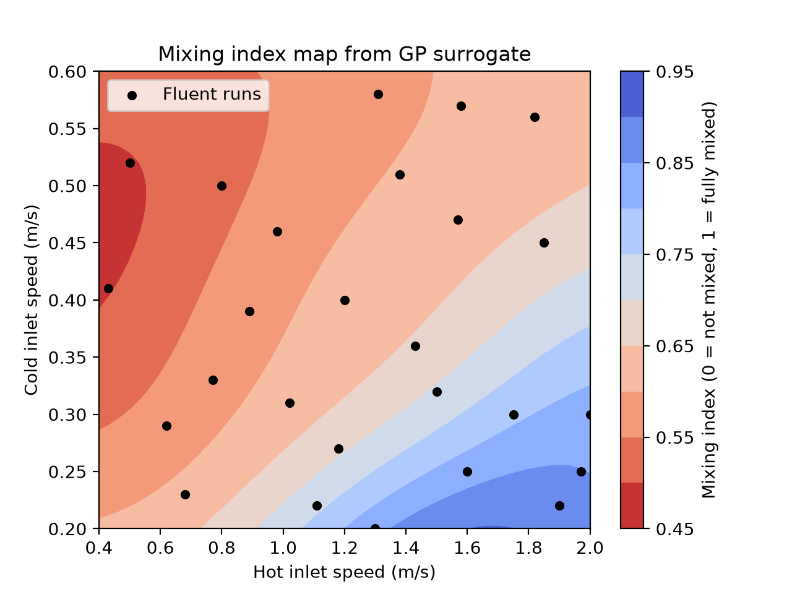
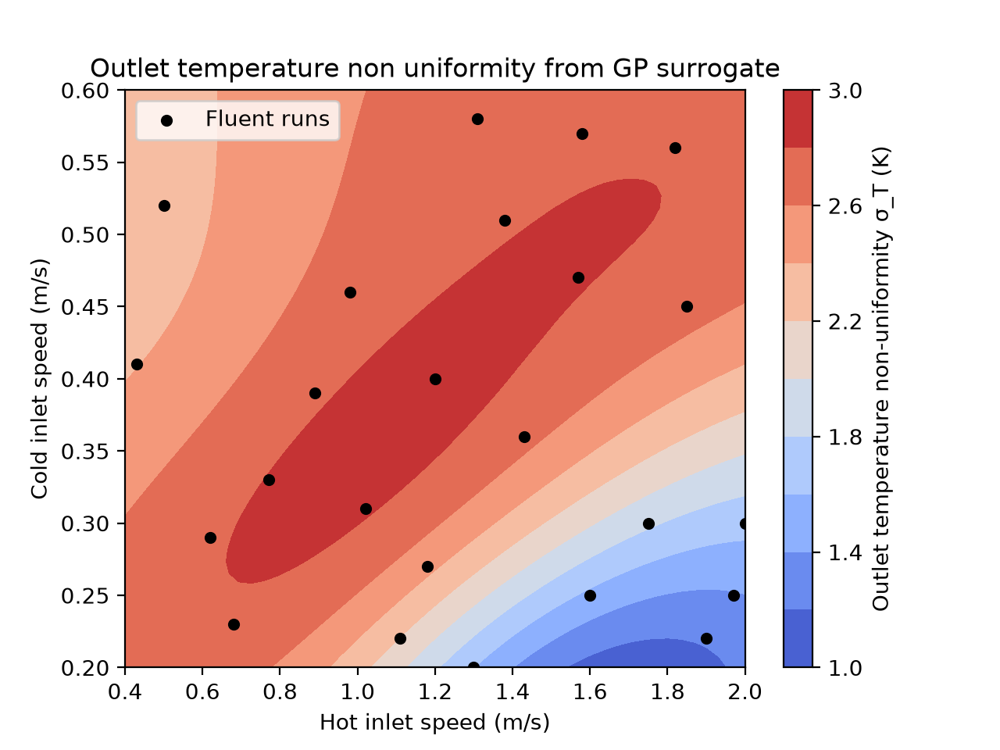
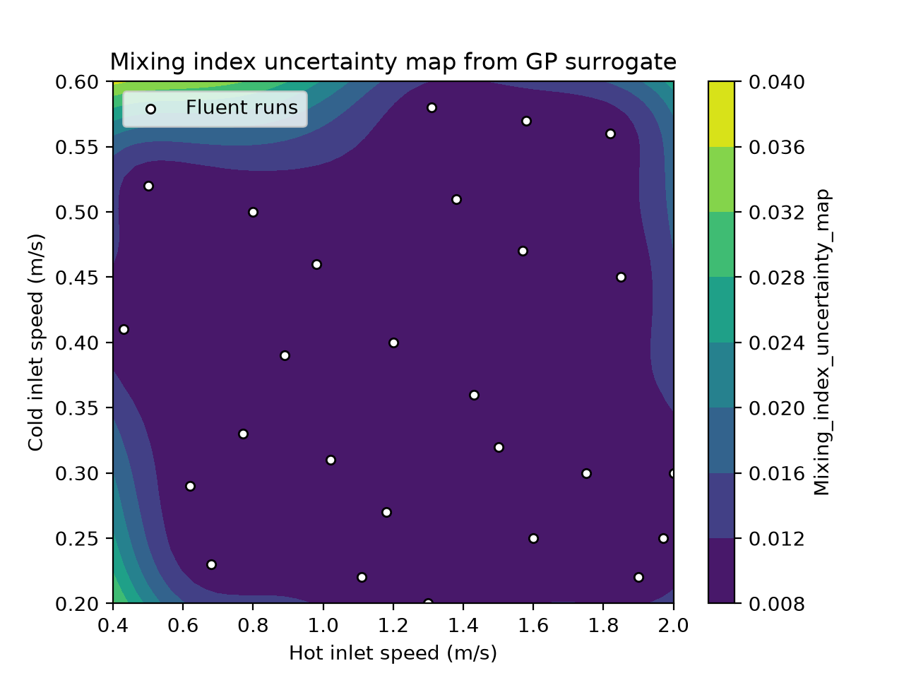
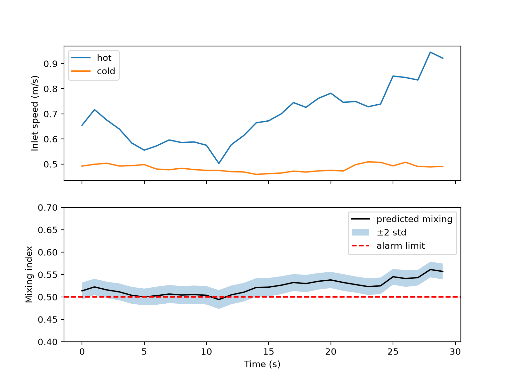

# surrogate-mixing-elbow

Hot and cold water meet in a pipe elbow. The case was run in Ansys Fluent 26 times with different inlet speeds, and small ML models were trained in Python to predict how well the water mixes at the outlet, without running Fluent again. The final model is used in a basic digital twin demo with simulated sensors.

This is a learning project. The CFD isn't validated.

## Setup

- Mixing elbow from the Ansys tutorial: cold water 20 °C in a 100 mm pipe, hot water 40 °C from a 25 mm side pipe
- Fluent 2026 R1 Student, half model with symmetry, 119k cells, steady k-epsilon, energy on
- Inputs: hot speed 0.4–2.0 m/s, cold speed 0.2–0.6 m/s
- Runs done automatically with Workbench design points (~3 min each)

Each run's outlet average temperature was checked against a hand mixing balance. All matched within 0.06 K. This also caught a bug where one parameter wasn't connected.

## Data

- `training_data.csv`: 19 runs
- `training_data_updated.csv`: 24 runs (+5 where the models first failed, at high hot/cold ratio)
- `training_data_final.csv`: 26 runs (+2 blind-test runs)

## Results

Targets: outlet temperature std σ_T (K), and a mixing index MI = 1 − σ_T / σ_unmixed (0 = unmixed, 1 = fully mixed), which corrects σ_T for the amount of hot water.

Leave-one-out on 24 runs:

| Model | σ_T R² | Mixing index R² |
|---|---|---|
| Dummy (average) | −0.09 | −0.09 |
| Linear | 0.37 | 0.90 |
| Polynomial (deg 2) | 0.85 | 0.97 |
| Gaussian process | 0.93 | 0.96 |

The GP on σ_T only reached 0.93 after 5 runs were added in the corner where it failed (it was 0.16 with 19 runs). The mixing index is a much smoother target, so even a linear model works.

Blind test: 2 new points were predicted before running them in Fluent.

| Hot / cold (m/s) | σ_T pred | σ_T Fluent | MI pred | MI Fluent |
|---|---|---|---|---|
| 1.50 / 0.32 | 2.33 ± 0.11 | 2.52 | 0.729 ± 0.017 | 0.698 |
| 0.80 / 0.50 | 2.53 ± 0.13 | 2.65 | 0.534 ± 0.019 | 0.537 |

All four are inside the GP's ±2 std range. That's only 2 points, though.

## Maps

GP trained on all 26 runs, 2,500 grid points.



A strong hot jet relative to the cold flow (bottom right) mixes best.





The GP is confident inside the data (std < 0.012) and unsure at the low-hot-speed corners. Hot 0.4 / cold 0.6 would be the most useful next run.

## Digital twin demo

The trained GP is saved once (`digital_twin/train.py`) and loaded by `digital_twin/twin.py`. Every second:

- simulated sensors give hot and cold speeds (random drift, kept inside the training range)
- the GP predicts the mixing index and its uncertainty
- it warns if mixing drops below 0.50, or if the uncertainty goes above 0.02 (outside known data)
- when mixing is poor, it tries 100 hot speeds and suggests the lowest one that reaches 0.55



The suggested hot speed always works out to a hot/cold ratio of about 1.8. The model picked that up from the Fluent data on its own.

The sensors are fake and nothing feeds back into the model, so this is a proof of concept of the monitoring and advice part of a twin, not a real one.

## Limitations

- No mesh study, no experimental validation, default water properties, coarse hot inlet
- Steady RANS is weak for jet mixing, so σ_T itself may be off, and the surrogate copies Fluent's errors
- Symmetry assumed
- Fluent's average is mass-weighted and its std is area-weighted, so the mixing index is approximate
- Blind test is only 2 points
- Twin uses simulated sensors; the alarm can flicker near the limit (no hysteresis yet)

## Run

```
# run from the top folder
pip install -r requirements.txt
python Mixing_Index/compare_model.py
python Mixing_Index/mixing_index_map.py
python digital_twin/train.py
python digital_twin/twin.py
```